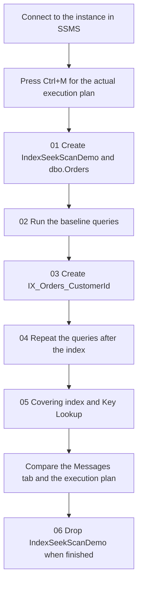

# SQL Server Index Seek vs. Index Scan

Practical T-SQL for comparing an Index Seek with an Index Scan on one SQL Server table. The scripts create a database, load a deterministic educational data set, run the same queries before and after a nonclustered index, and then add a covering index so you can inspect a Key Lookup for yourself.

Repository: [https://github.com/atifch319/sqlserver-index-seek-vs-scan](https://github.com/atifch319/sqlserver-index-seek-vs-scan)

## Learning objectives

- See how a clustered primary key and a nonclustered index change the access paths available to a query.
- Compare a selective `CustomerId` predicate with one that returns a large share of the table.
- Read logical reads, CPU time, and elapsed time for the same statement text.
- See when a nonclustered index can still need a Key Lookup.
- See what a covering index stores, and why that can remove the lookup.
- Treat the execution plan as a cost choice made from statistics. A seek is not automatically the fastest plan, and a scan is not automatically a problem.

## Index Seek and Index Scan

| | Index Seek | Index Scan |
| --- | --- | --- |
| What it does | Uses the index key order to navigate to the entries that match the predicate. | Reads index entries across a range of the structure, or across the whole structure. |
| When it tends to fit | The predicate is selective, a useful index key exists, and the estimated cost is lower than the alternatives. | The query returns many rows, no useful seek key exists, or repeated lookups would read more pages than reading the index once. |
| What the operator name does not settle | A seek can still be expensive when it is followed by many lookups. | A scan can be the cheaper plan. The optimizer picks from estimated cost, not from the operator name. |

Selectivity describes how narrowly a predicate filters the available rows. A lookup that returns a small subset can favor an index. A query that returns a large proportion of the rows can favor a scan, because reading the structure once may cost less than finding each match separately.

Statistics help the optimizer estimate how many rows a predicate will return. The histogram and density summary are inputs to that estimate. Stale or unrepresentative statistics can produce a poor estimate, and a poor estimate can produce a poor plan. Statistics are not an access path. An index is.

## Learning workflow

Open each script in SQL Server Management Studio, press `Ctrl+M`, and execute the files in this order. Script 06 is the cleanup step. Run it only when you are finished.



## Prerequisites

- SQL Server 2016 or later, or a compatible Azure SQL target where you may create a database. The scripts use `THROW`, the `date` type, and `INCLUDE` on a nonclustered index.
- SQL Server Management Studio (SSMS), so you can use `Ctrl+M` and read the execution plan.
- Permission to create the database `IndexSeekScanDemo`. `CREATE DATABASE` requires `sysadmin` or the `dbcreator` server role. The principal that creates the database owns it and can create the table, indexes, and statistics.
- For a later reload, permission to drop and create `dbo.Orders`, typically `db_owner` in `IndexSeekScanDemo`.
- `sqlcmd` can run the same files. SSMS is the tool these instructions use for the actual plan.

The scripts contain no passwords. On a local instance, Windows authentication is enough.

## Setup

Run `sql/01-create-database-and-data.sql` first.

The script creates `IndexSeekScanDemo` when that database is missing. When the new database has no user tables, it sets `SIMPLE` recovery so the load does not require log backups. A later run does not change the recovery model.

It then creates `dbo.Orders` and loads 100,000 deterministic rows. `OrderId` is an explicit `int` clustered primary key, not an `IDENTITY` column, so each reload uses the same keys. `CustomerId` is an `int` and is not a foreign key. `OrderDate` is a `date`. `Status` is `varchar(12)`. `TotalAmount` is `decimal(12, 2)`.

The row set is educational. It is a fixed pattern chosen so two customer predicates have different selectivity. It is not a model of a production workload.

After the load, the script checks the row counts and stops if they are wrong. It expects 100,000 orders, 100 rows for `CustomerId = 42`, 19,900 rows for `CustomerId = 7`, and 80,000 `Completed` orders. It then creates full-scan statistics on `CustomerId`, `OrderDate`, and `Status`, updates statistics on `PK_Orders`, and prints the date range, amount range, distinct customer count, and status counts.

In SSMS:

1. Open `sql/01-create-database-and-data.sql`.
2. Connect to the instance you intend to use.
3. Execute the script.
4. Confirm the result grid shows `TotalRows` 100000, `Customer42Rows` 100, `Customer7Rows` 19900, and `CompletedRows` 80000.

Rerunning this script reuses the database and drops only `dbo.Orders`, including its indexes. If `IndexSeekScanDemo` contains any other user table, the script stops and leaves that table in place.

From a shell, against the default local instance:

```text
sqlcmd -S localhost -E -b -i sql\01-create-database-and-data.sql
```

`-b` makes `sqlcmd` stop when a batch fails. Change `-S` to your instance name.

## Execution order

Run these files in order against the same instance. Press `Ctrl+M` before scripts 02, 04, and 05.

| Order | Script | Purpose |
| --- | --- | --- |
| 1 | `sql/01-create-database-and-data.sql` | Create `IndexSeekScanDemo`, recreate `dbo.Orders`, and load 100,000 rows. |
| 2 | `sql/02-baseline-queries.sql` | Run the queries while `PK_Orders` is the only index. |
| 3 | `sql/03-create-customer-index.sql` | Create `IX_Orders_CustomerId` when that name is absent. |
| 4 | `sql/04-queries-after-index.sql` | Repeat the baseline statements, then force one extra plan. |
| 5 | `sql/05-covering-index-and-key-lookup.sql` | Compare a narrow index, a Key Lookup hint, and a covering index. |
| 6 | `sql/06-cleanup.sql` | Drop `IndexSeekScanDemo`. Run this only when you are finished. |

```text
sqlcmd -S localhost -E -b -i sql\01-create-database-and-data.sql
sqlcmd -S localhost -E -b -i sql\02-baseline-queries.sql
sqlcmd -S localhost -E -b -i sql\03-create-customer-index.sql
sqlcmd -S localhost -E -b -i sql\04-queries-after-index.sql
sqlcmd -S localhost -E -b -i sql\05-covering-index-and-key-lookup.sql
```

Leave `sql\06-cleanup.sql` until you want the database removed.

## CustomerId 42 and CustomerId 7

Both predicates use the same query shape. The difference is how many rows match.

For each generated number `n` from 1 through 100,000:

- `CustomerId` is 42 when `n` is a multiple of 1000. That is 100 rows, 0.1 percent of the table.
- `CustomerId` is 7 when `n` is a multiple of 5 and not a multiple of 1000. That is 19,900 rows, 19.9 percent of the table.
- Otherwise `CustomerId` is `1000 + (n % 5000)`.

`CustomerId = 42` is the selective lookup:

```sql
SELECT OrderId, CustomerId, OrderDate, Status, TotalAmount
FROM dbo.Orders
WHERE CustomerId = 42
OPTION (RECOMPILE);
```

`CustomerId = 7` is the broader lookup:

```sql
SELECT OrderId, CustomerId, OrderDate, Status, TotalAmount
FROM dbo.Orders
WHERE CustomerId = 7
OPTION (RECOMPILE);
```

Customer 42 is a small slice, so an index on `CustomerId` has a selective key to navigate. Customer 7 matches many rows. Those rows are spread through `PK_Orders`, because the clustered key is `OrderId`. Reading a large share of a table can make a scan a sensible choice: one pass over the clustered index can cost less than a separate lookup for every match.

The statements include `OPTION (RECOMPILE)` so SQL Server optimizes each literal from the current histogram. Without it, simple parameterization can cache one plan and reuse the first customer's estimate for the other customer. Compile cost is part of CPU time and elapsed time. Logical reads are the steadier comparison. Compare execution 2 in script 02 with execution 2 of the same statement in script 04.

Script 02 also aggregates orders with `OrderDate` from 1 January 2022 through 1 January 2024. That predicate is not `CustomerId`, so the index created in script 03 does not order it.

## Actual execution plan in SSMS

1. Open the script and connect to the instance that holds `IndexSeekScanDemo`.
2. Press `Ctrl+M`, or choose Query > Include Actual Execution Plan. The toolbar button stays selected while the setting is on.
3. Execute the script.
4. Open the Execution plan tab after the batch finishes.
5. Select an operator and press `F4`. Read the index name, seek predicates, estimated number of rows, and actual number of rows.
6. Open the Messages tab for the `STATISTICS IO` and `STATISTICS TIME` lines.

`Ctrl+L` shows an estimated plan only. It has no actual row counts. The percentage drawn on an operator is an estimated cost share, not a measured elapsed time.

A large gap between estimated rows and actual rows is a reason to inspect the statistics and the predicate.

For the 19,900-row result, Query > Query Options > Results > Discard results after execution skips drawing the grid. Logical reads stay the same.

## Compare STATISTICS IO and STATISTICS TIME

Scripts 02, 04, and 05 already run these statements around each measured query:

```sql
SET STATISTICS IO ON;
SET STATISTICS TIME ON;
```

Read the output in the Messages tab.

- **Logical reads** are 8 KB pages read from the buffer pool, including pages just brought in from disk. Compare this number for the same statement in script 02 and script 04.
- **Physical reads** are pages that were not already in cache. A second execution often shows zero physical reads because the pages were cached. That does not mean the query read nothing.
- **CPU time** and **elapsed time** are millisecond figures for the statement. Elapsed time includes waits. Sending 19,900 rows to SSMS adds time that is easy to mix up with the storage work.
- **Scan count** counts how the access method was started. A seek can still report `Scan count 1`. Use the operator in the execution plan to tell a seek from a scan.

Use execution 2. Execution 1 can include extra compile work. Cache state, server load, parallelism, parameter values, statistics, and the SQL Server version can all move CPU time and elapsed time. One timing result is not universal proof.

The result grid shows the rows returned. The plan properties show estimated rows and actual rows. Script 01, and the cardinality query at the top of script 02, print how many orders belong to customers 7 and 42.

## Covering index and Key Lookup

Script 03 creates:

```sql
CREATE NONCLUSTERED INDEX IX_Orders_CustomerId
ON dbo.Orders (CustomerId);
```

The key is `CustomerId`. Each leaf row also stores `OrderId`, because `OrderId` is the clustered key and the row locator. `OrderDate`, `Status`, and `TotalAmount` are not in this index. If the optimizer uses this index for a query that needs those columns, it also performs a Key Lookup into `PK_Orders` for each qualifying key. One lookup is ordinary. Repeating it for many rows can cost more than a Clustered Index Scan. A Key Lookup is not inherently a bad operator. Its cost depends on how many lookups are required and what the alternative plan would read.

On a heap, the matching operator is a RID Lookup. `dbo.Orders` has a clustered primary key, so the extra lookup is a Key Lookup.

Script 04 repeats the baseline queries with only this nonclustered index in place, unless the covering index already exists. It then runs one extra statement that is not part of the before-and-after pair. The hint forces `IX_Orders_CustomerId` for `CustomerId = 7` so you can inspect that access path and its logical reads. The hint is a teaching tool. The unconstrained statements are the optimizer's choice.

Script 05 Part A also selects only `OrderId` and `CustomerId` for customer 42. Those two columns can be returned from `IX_Orders_CustomerId`, because `OrderId` is already stored there. Part A then runs the full-column query, plus the same full-column query with an index hint, so a Key Lookup can be inspected when you want that operator on screen.

Part B creates:

```sql
CREATE NONCLUSTERED INDEX IX_Orders_CustomerId_Covering
ON dbo.Orders (CustomerId)
INCLUDE (OrderDate, Status, TotalAmount);
```

A covering index holds the key columns and the included columns a query needs. `OrderId` is present as the row locator, so this index can return `OrderId`, `CustomerId`, `OrderDate`, `Status`, and `TotalAmount` without going back to `PK_Orders` for those columns. The extra columns take more storage, and SQL Server maintains the index when the key or included columns change.

The project keeps both nonclustered indexes so the plans can be compared. They overlap: the covering index can serve the same `CustomerId` predicate and also covers the extra columns. After the comparison, the commented `DROP INDEX` at the bottom of script 05 can remove `IX_Orders_CustomerId` if you no longer want the side-by-side example. That statement is commented out. It does not run unless you uncomment it.

Rerunning script 05 drops `IX_Orders_CustomerId_Covering` when it already exists, repeats Part A, and creates the covering index again. It does not drop `IX_Orders_CustomerId`, `dbo.Orders`, or any other database.

Script 03 is safe to rerun: if `IX_Orders_CustomerId` already exists, it leaves that index in place.

## Expected observations

These are the comparisons the scripts are built to make visible. They are expectations, not measured plans or timings. SQL Server chooses from data distribution, statistics, the requested columns, version, and estimated cost. Capture the actual plan and the Messages tab on your instance before you treat any operator as the result.

- Before `IX_Orders_CustomerId` exists, a `CustomerId` predicate has no matching index key. `PK_Orders` is keyed by `OrderId`, so a scan of that clustered index is the usual access path. Script 02 tells you to record whatever operator you actually get.
- After the narrow index exists, customer 42 is a candidate for an Index Seek. The full-column `SELECT` still needs columns that are not in `IX_Orders_CustomerId`, so a seek plan can include a Key Lookup.
- Customer 7 returns 19,900 rows. The optimizer can still choose a scan of `PK_Orders` when a lookup per row would cost more than reading the clustered index. Script 04's hinted statement is there so you can compare that forced path with the unconstrained plan.
- The `OrderDate` aggregate does not filter on `CustomerId`. An index on `CustomerId` does not by itself give that predicate an ordered path.
- The two-column query in script 05 can be covered by `IX_Orders_CustomerId` because `OrderId` is the row locator.
- After `IX_Orders_CustomerId_Covering` exists, the full-column query can be satisfied from that index without a Key Lookup. The optimizer may still choose another index when its estimate says that plan is cheaper.
- Compare logical reads, then CPU time and elapsed time, using execution 2 of the matching statement text. A lower logical-read count supports a cheaper page choice on that run. It does not, by itself, prove that every seek is faster on every server.

## Observed results

The facts below come from a successful SSMS execution of these scripts. They describe the database that was created. They do not include an execution-plan operator, a logical-read count, or a timing.

| Item | Observed |
| --- | --- |
| Database | `IndexSeekScanDemo` |
| Table | `dbo.Orders` |
| Total rows | 100,000 |
| Distinct customers | 4,002 |
| Customer 42 | 100 orders |
| Customer 7 | 19,900 orders |
| Indexes present after script 05 | `PK_Orders`, `IX_Orders_CustomerId`, `IX_Orders_CustomerId_Covering` |

The six SQL scripts completed successfully in SSMS. Operator names, logical reads, and elapsed times from that run are not recorded here.

## Troubleshooting

- Script 04 or 05 reports a missing object. Run the files in the order above. `USE IndexSeekScanDemo` fails when script 01 has not created the database. Script 04 and script 05 raise an error when `dbo.Orders` or `IX_Orders_CustomerId` is missing.
- Script 02 prints a warning that a nonclustered index already exists. Those results are not a pre-index baseline. Rerun script 01, which drops and recreates `dbo.Orders`, before comparing them with script 04.
- Script 04 prints a warning that `IX_Orders_CustomerId_Covering` already exists. The optimizer may use it. For a comparison against only the narrow index, rerun script 01 and then scripts 03 and 04.
- The Execution plan tab is empty. `Ctrl+M` was off. `Ctrl+L` is an estimated plan and has no actual row counts.
- `STATISTICS IO` says `Scan count 1` for a seek. Read the operator in the plan. That counter is not the operator name.
- Customer 7 and customer 42 share one estimate. `OPTION (RECOMPILE)` was removed, and simple parameterization reused the first literal. Keep the option that the scripts already include when you want each literal estimated on its own.
- A predicate such as `YEAR(OrderDate) = 2023`, or `CONVERT(varchar(20), CustomerId) = '42'`, hides the column from a seek. The scripts filter on the bare columns.
- Elapsed time for customer 7 moves between runs. Compare logical reads, and discard the result grid when you care about server time.
- An index hint is still in a query that was only meant to reveal an operator. The unconstrained statements show the optimizer's choice.
- Estimates drift after data changes made outside these scripts. Script 01 reloads the rows and refreshes statistics.
- Script 01 stops because another user table is in `IndexSeekScanDemo`. It will not drop that table. Move or drop the other table yourself, then rerun script 01.
- Script 03 prints that `IX_Orders_CustomerId` already exists. That rerun is working as written. It does not drop the index.
- Script 06 was executed against the wrong instance. Confirm the connection before you run it. The script drops only `IndexSeekScanDemo`, and a second run drops nothing when the database is already gone.

## Cleanup

`sql/06-cleanup.sql` deletes the practice database.

It is destructive. The script switches to `master`, sets `IndexSeekScanDemo` to `SINGLE_USER WITH ROLLBACK IMMEDIATE`, and drops that database. Other sessions in `IndexSeekScanDemo` are rolled back. Every object inside the database is removed. No other database is dropped. Run it only when you are finished, and only on the instance you mean to change.

```text
sqlcmd -S localhost -E -b -i sql\06-cleanup.sql
```

Running it again, after the database is gone, prints a message and drops nothing. Dropping the database requires ownership of `IndexSeekScanDemo` or `sysadmin`.

## Repository

[https://github.com/atifch319/sqlserver-index-seek-vs-scan](https://github.com/atifch319/sqlserver-index-seek-vs-scan)
